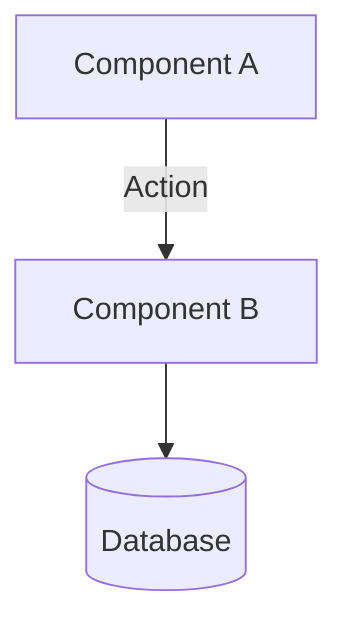
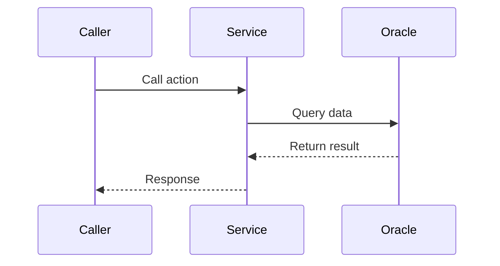

# Design Document: <Feature Name>

## 1. Overview
[Tóm tắt 1 paragraph về cách tiếp cận kỹ thuật (Technical Approach). Ví dụ: Sử dụng In-Database ELT kết hợp Exchange Partition để nạp dữ liệu.]

## 2. Architecture

### 2.1 Component Diagram


### 2.2 Components
- **ComponentA**: [Trách nhiệm của component này]
- **ComponentB**: [Trách nhiệm của component này]

## 3. Data Model / Schema
[Chèn SQL DDL, Python Interface, hoặc cấu trúc JSON cần thiết]
```sql
CREATE TABLE RETAIL_DTM.EXAMPLE_TABLE (
    DIMENSION_KEY NUMBER PRIMARY KEY,
    -- ...
);
```

### 3.1 Strict Data Mapping (BẮT BUỘC)
[Dựa trên file DDL và `raw_sources/models/RETAIL_DATA_MODEL.md`. Cấm mọi hành vi đoán mò tên cột.]
| Cột trong Fact | Lấy từ Pool nào? | Thông qua điều kiện/Join nào? | Tên cột chính xác trong Pool |
|---|---|---|---|
| `CUSTOMER_SK` | `DIM_RETAIL_CUST` | Lấy mẫu ngẫu nhiên (Sample) | `DIMENSION_KEY` |
| `COMPANY_SK` | `DIM_RETAIL_COMPANY` | Lookup qua `CO_CODE` của nhánh CUST | `DIMENSION_KEY` |

## 4. API / Interfaces / Methods
[Danh sách các hàm, tham số đầu vào và đầu ra]
- `def function_name(param: type) -> return_type:` — Description of what it does.

## 5. Data Flow / Sequence Diagram


## 6. Error Handling
| Error Case | Exception/Code | Handling Strategy |
|---|---|---|
| Dữ liệu rác (Nulls) | `ValueError` | Ghi log cảnh báo và bỏ qua dòng đó |
| Mất kết nối DB | `oracledb.DatabaseError` | Rollback transaction, retry 3 lần |

## 7. Testing Strategy
- **Unit Tests:** Kiểm tra các hàm logic độc lập (e.g., hàm tính tuổi từ CCCD).
- **Integration Tests:** Chạy `forge run` với số lượng nhỏ (10 dòng) để verify Insert thành công.
- **Audit Checks:** Chạy `forge audit` để verify Không mồ côi (No Orphans) và Tỷ lệ Null.

## 8. Open Questions / Trade-offs
[Ghi chú các quyết định khó khăn, ví dụ: "Chọn Trade-off dùng RAM nhiều hơn để đổi lấy tốc độ O(1) Lookup".]